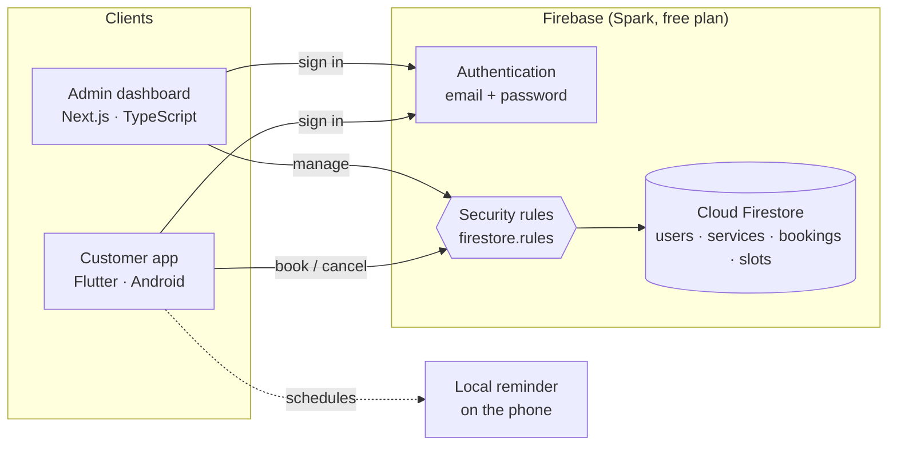

# Salon booking app + admin dashboard

A complete booking system for a small salon or clinic. Customers book
appointments in an **Android app**, and the owner manages everything in a **web
dashboard**. Both share one secure Firebase backend.

| Customer app (Flutter) | Admin dashboard (Next.js) |
| ---------------------- | ------------------------- |
| [](https://youtube.com/shorts/Vx8c27PwZs8) | [](https://youtu.be/4zeIR4EaPKc) |
| ▶ [Watch the app demo](https://youtube.com/shorts/Vx8c27PwZs8) | ▶ [Watch the dashboard demo](https://youtu.be/4zeIR4EaPKc) |
| | _Phase 4 dashboard recording (with title card): `<VIDEO LINK>`_ |

<!-- Screenshots: replace with phone captures from demo_videos/ when ready. -->
| Services | Choose a time | My bookings | Reminder |
| -------- | ------------- | ----------- | -------- |
| `<SCREENSHOT: services>` | `<SCREENSHOT: choose time>` | `<SCREENSHOT: my bookings>` |  |

## Features

**Customer app (Android)**
- Sign up and log in; the session is remembered
- Browse services with price and duration
- Book in three taps: service → date (next 14 days) → free time
- Times already taken are greyed out live; **double bookings are impossible**
- My bookings: upcoming and past, cancel with one tap (the time is freed for others)
- A reminder notification one hour before each appointment
- Light and dark mode, large-text friendly, clear messages instead of errors

**Admin dashboard (web)**
- Only admin accounts get in; everyone else sees "Access denied"
- Overview: today's appointments, upcoming and cancelled counts
- All bookings with customer details, filters by date, status and service, live updates
- Cancel any booking (frees the slot), add, edit and deactivate services

## How it works



There is no custom server. Each app talks to Firebase directly, and the
**security rules** decide what every user may read or write. A booking and its
time slot are written together in one transaction; the slot's ID is the service
plus the start time, so a second booking for the same time is rejected by the
database itself.

## Tech stack

| Part | Built with |
| ---- | ---------- |
| Customer app | Flutter, Provider, `cloud_firestore`, `firebase_auth`, `flutter_local_notifications` |
| Admin dashboard | Next.js (App Router), React, TypeScript, Tailwind CSS, Firebase Web SDK |
| Backend | Firebase Authentication, Cloud Firestore, security rules (no Cloud Functions) |
| Testing | Flutter widget tests, Vitest, Playwright, `@firebase/rules-unit-testing`, Firebase Emulator Suite |

## Security

- **Least privilege by default:** customers read and change only their own
  bookings and profile. Nobody can make themselves an admin; admin roles are
  set only in the Firebase console.
- **Rules are tested:** 22 automated tests check what guests, customers and
  admins can and can't do, on a local emulator. A reviewed hardening proposal
  is in [docs/phase4-security.md](docs/phase4-security.md).
- **Bookings are history:** they can be cancelled but never deleted or edited.
- **No secrets in the repository:** Firebase config files are generated locally
  and git-ignored. All demos use made-up data on local emulators.

## Run it locally (no Firebase account needed)

You need Node.js 20.9+ and the Firebase CLI (`npm install -g firebase-tools`).
For the app, you also need Flutter.

```
cd admin_web
npm install
npm run emulators                     # terminal 1: local Auth + Firestore

# terminal 2 (PowerShell)
$env:FIRESTORE_EMULATOR_HOST = "127.0.0.1:8080"
$env:FIREBASE_AUTH_EMULATOR_HOST = "127.0.0.1:9099"
npm run seed:emulator                 # "Glow Salon" demo data
npm run test:rules                    # security rules tests
npm run test:e2e:emulator             # dashboard tests in a real browser
```

Demo admin: `mona@glow-salon.example` / `demo-only-password` (works on the
emulator only). Full setup, including connecting your own Firebase project and
running the app on a phone: [docs/setup.md](docs/setup.md).

## Project docs

- [docs/setup.md](docs/setup.md): developer setup, data model, troubleshooting
- [admin_web/README.md](admin_web/README.md): dashboard setup and tests
- Plain-English walkthroughs: [phase 1](docs/phase1-explained.md) ·
  [phase 2](docs/phase2-explained.md) · [phase 3](docs/phase3-explained.md) ·
  [phase 4](docs/phase4-explained.md)
